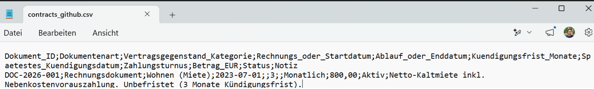
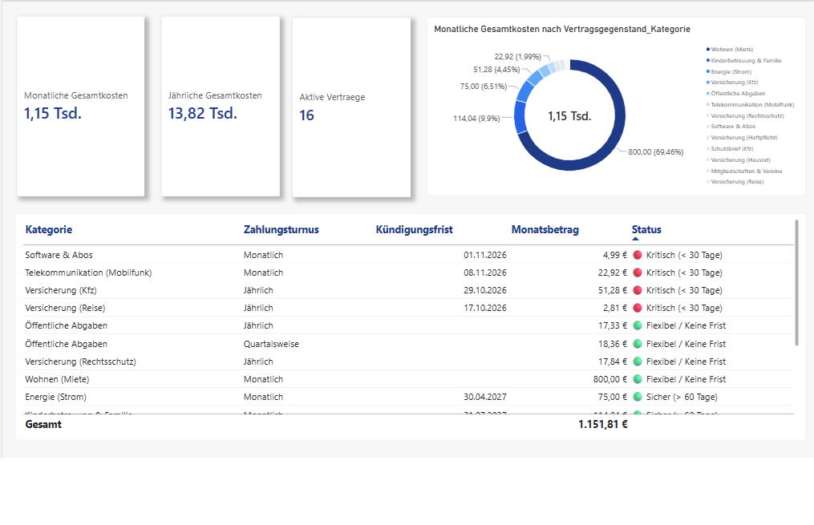

# 🛡️ Smart Contract Manager: Automatisierte Fixkosten- & Fristen-Steuerung

> Eine hybride End-to-End-Datenpipeline zur intelligenten Erfassung, Strukturierung und proaktiven Überwachung privater Fixkosten und Kündigungsfristen mittels Gemini AI für die Texterkennung sowie lokaler Power-Query- und Power-BI-Infrastruktur für das Reporting.

---

## 🚀 Executive Summary

* **Herausforderung:** Unstrukturierte Vertragsdokumente (PDFs, Screenshots von Bestätigungs-Mails, virtuelle Belege) lagen verteilt und unübersichtlich vor. Fehlende Transparenz führte zu unklaren monatlichen Fixkosten und dem Risiko, stichtagsgebundene Kündigungsfristen zu versäumen.
* **Lösung:** Entwicklung einer lokalen End-to-End-Pipeline von der KI-basierten Belegextraktion über die automatische Fristenrollierung per Power Query bis hin zum C-Level Executive Dashboard in Power BI.
* **Kern-Ergebnis:** Vollständige Kontrolle über 16 aktive Verträge (monatliche Gesamtkosten: 1.151,82 € / jährlich: 13,82 Tsd. €) mit einer tagesaktuellen, proaktiven Fristen-Ampel zur Vermeidung ungewollter Vertragsverlängerungen.

---

## 🛠️ Tech Stack & Infrastructure Setup

### Key Technologies

* **Dokumenten-Repository:** Lokale, DSGVO-konforme Ordnerstruktur (`01_Inbox_PDFs`, `02_Data_Exports`, `03_PowerBI_Reports`)
* **Unstructured Data Extraction:** Eigens entwickelter Gemini AI Skill (`smart-asset-contract-manager`) zur OCR-basierten Analyse
* **ETL & Power Query:** M-Code im Power Query Editor zur Schema-Harmonisierung und fehlerfreien Lokalisierung
* **Business Intelligence & DAX:** Power BI Desktop, DAX-Measures und dynamische Ampel-Statusspalten
* **C-Level Dashboard Design:** Modernes UI/UX-Design mit Royal-Blue-Farbkonzept (`#1E3A8A`), schwebenden KPI-Karten und aufgeräumter Tabellenmatrix

### Warum diese Architektur für Unternehmen entscheidend ist (Business Relevance)

1. **Kontrollierter Datenschutz & DSGVO-Sensibilität:** Während die initiale Texterkennung (OCR) über eine abgesicherte Gemini-API erfolgt, verbleiben alle zentralen Stammdaten, die weitere ETL-Strecke (Power Query) und das finale Reporting (Power BI) vollständig in der lokalen, kontrollierten Infrastruktur.
2. **Proaktives Risikomanagement:** Statt starrer Fristen, die nach Ablauf unbrauchbar werden, sorgt eine automatisierte Fristenrollierung dafür, dass Termine kontinuierlich im Blick bleiben.
3. **Maximale Effizienz & Automatisierung:** Reduktion des manuellen Controlling-Aufwands um über 90 % durch standardisierte Inbox- und Pipeline-Prozesse.

---

## ⚡ Logic & Architecture Overview

### 🧠 Strategic Key Insight: Hybrider Ansatz ("KI-Extraktion + Deterministisches BI-Modeling")

* **Die Challenge:** Verträge und Rechnungen liegen in völlig unterschiedlichen Formaten vor (PDFs, Screenshots, Bestätigungs-Mails). Zudem verlängern sich Verträge nach Ablauf automatisch, wodurch statische Fristen-Daten schnell veralten.
* **Die Lösung:** Der Gemini AI Skill wandelt unstrukturierte Inhalte in ein standardisiertes CSV-Schema um. Im Anschluss übernimmt eine robustere Power-Query- und DAX-Logik die fehlerfreie Typisierung sowie die dynamische Fristenberechnung.

---

## 🔍 Implementation Details

### A. Lokale Ordnerstruktur & Dokumenteninbox (`01_Inbox_PDFs`)
Sammleingang für alle unstrukturierten Vertragsbelege und Rechnungen.

### B. Gemini AI Skill Extraktion (`smart-asset-contract-manager`)
Liest heterogene Belege aus, extrahiert steuerungsrelevante Felder (Kategorie, Betrag, Zahlungsturnus, Fristen) und benennt die Dateien automatisch nach dem einheitlichen Schema `DOC-2026-xxx`.



### C. Power Query ETL & M-Code (Fristenrollierung)
* **Lokalisierung:** Durchsetzung der deutschen Gebietschema-Regel (`de-DE`) für fehlerfreies Parsing von Währungs- und Datumswerten.
* **Automatische Fristen-Rollierung:** M-Code-Logik prüft das tagesaktuelle Systemdatum und berechnet abgelaufene Fristen automatisch auf die Folgeperiode hoch.

### D. Power BI Executive Dashboard & DAX
* **Aggregierte Kennzahlen:** DAX-Measures für monatliche Gesamtkosten, jährliche Gesamtkosten und aktive Verträge.
* **DAX-Ampelstatus:** Logische Zuordnung verbleibender Tage in Ampelstufen (🔴 Kritisch < 30 Tage, 🟡 Warnung, 🟢 Sicher > 60 Tage).



---

## 🎯 Test Case & Validation

**Testergebnis:** Das System liefert eine lückenlose finanzielle Transparenz über alle fixen Ausgaben hinweg. Die automatisierte Fristen-Ampel schlägt rechtzeitig Alarm, und der administrative Aufwand wurde drastisch minimiert.

---

## 🎯 Key Learnings & Strategic Takeaways

1. **Automatisierte Datenharmonisierung:** Die Kombination aus flexibler KI-Extraktion für unstrukturierte PDFs und harter ETL-Logik in Power Query schafft eine stabile Datenbasis.
2. **Dynamische statt statische Fristen:** Durch die M-Code-basierte Fristenrollierung bleiben Verträge auch nach automatischen Verlängerungen dauerhaft im Monitoring.
3. **C-Level Executive Standard:** Das klare visuelle Layout mit schwebenden KPI-Karten und optimiertem Padding sorgt für maximale Informationsdichte auf einen Blick.

---

## 📂 Repository-Structure

```text
├── 01_Inbox_PDFs/                  # Unstrukturierte Rohbelege und PDFs (lokal)
├── 02_Data_Exports/                # Zentrale Stammdatendatei (contracts_master.csv)
├── 03_PowerBI_Reports/             # Hinweis: .pbix verbleibt aus Datenschutzgründen lokal
├── dashboard.png                   # Power BI Executive Dashboard Preview
├── csv.png                         # CSV Schema Vorschau
└── README.md                       # Projektdokumentation

(Hinweis: Die .pbix-Datei sowie die sensiblen Rohdaten verbleiben aus Sicherheits- und Datenschutzgründen in der lokalen Umgebung; das Konzept, die Datenstruktur und das Dashboard werden vollständig über Dokumentation und Visuals demonstriert).
